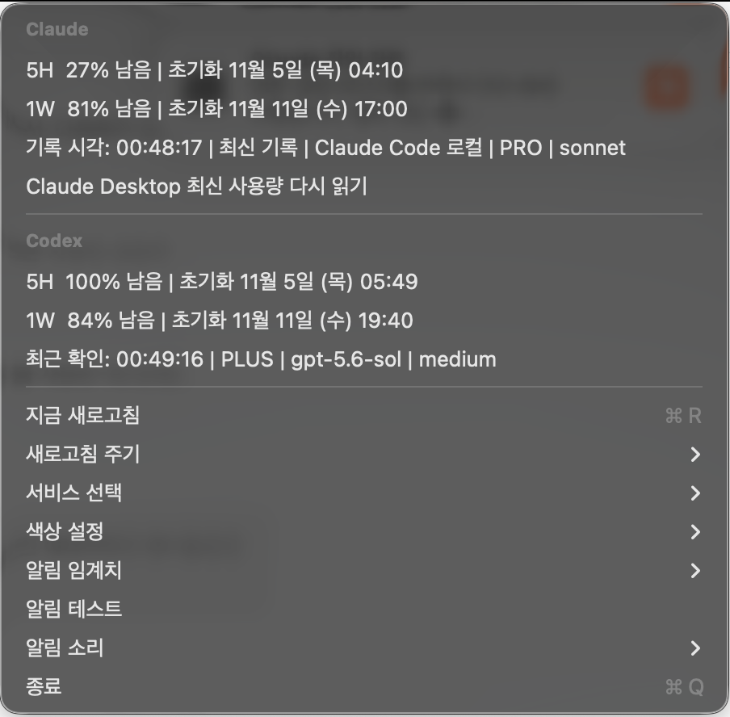

[English](README.md) · **한국어**

# AI Usage Bar

**Claude**와 **Codex(ChatGPT)**의 5시간·주간 한도가 얼마나 남았는지 보여 주고, 5시간 창이 리셋되기 전에 한도가 넉넉히
남아 있으면 미리 알려 주는 macOS 메뉴 막대 앱입니다.

프롬프트를 보내거나 모델에 무언가를 시키지 않습니다. (다만 이것이 "비용이나 위험이 전혀 없다"는 뜻은 **아닙니다**.
[정확성과 한계](#정확성과-한계)를 보세요.)

> 독립적인 비공식 도구이며 Anthropic, OpenAI와 관련이 없습니다. 일부 기능은 문서화되지 않은 인터페이스에 기대고 있으니
> 사용 전에 [정확성과 한계](#정확성과-한계)와 [면책 조항](#면책-조항)을 읽어 주세요.

## 화면

**메뉴 막대** — 왼쪽이 Codex, 오른쪽이 Claude입니다. 위 숫자는 5시간 **남은 %**, 아래 숫자는 주간 남은 %입니다.
주황색은 5시간 창, 파란색은 주간 창입니다. 이 스크린샷에서는 Codex 100 / 84, Claude 27 / 81입니다.


**상세 메뉴** — 리셋 시각, 최근 확인 시각, 요금제, 모델, 설정이 들어 있습니다. 이 스크린샷에서는 Claude 27% / 81%,
Codex 100% / 84% 남았습니다.



> 스크린샷은 이전 빌드에서 찍은 것입니다. 이후에 생긴 메뉴(리셋 임박 알림, 사용 코치, 주간 권장량 줄, 실시간 조회와
> 자동 갱신 설정)는 보이지 않고, 믿을 수 없는 값은 이제 숫자 대신 **오래됨** / **알 수 없음**으로 표시됩니다.

둘 중 하나만 쓴다면 처음 실행할 때(또는 언제든 메뉴에서) 그 서비스만 고르세요.

## 기능

- Claude와 Codex의 5시간·주간 **남은 %**를 메뉴 막대 한 칸에 표시
- 상세 메뉴에 리셋 시각, 최근 확인 시각, 요금제, 모델 표시. 새로고침 주기 선택(30초 / 1분 / 5분)
- **틀린 숫자 대신 "오래됨/알 수 없음".** 오래됐거나 이미 리셋된 창의 값은 막대에서 `—`로, 메뉴에서 *오래됨*으로
  표시하며 알림이나 계획에는 쓰이지 않습니다.
- 임계치 알림(예: 사용 20/40/60/80/90/95 %), 사용자 지정 임계치, 알림음 선택, 알림 테스트
- **리셋 임박 알림**: 5시간 창이 리셋되기 직전에 한도가 넉넉히 남아 있으면 알려 줍니다(기본 꺼짐. 주간 한도가 거의
  바닥이면 건너뛰고, "조용한 시간"을 따릅니다. 시간대는 여러 개 지정 가능)
- **사용 코치**: 이번 5시간 창을 여러 구간(예: 30 / 30 / 30)으로 나눠 구간이 시작될 때마다 알림, 사용 속도 경고
  ("이 속도면 리셋 전에 한도가 다 차요"), 하루 권장량("하루 약 20 %")과 일별 사용 기록, 한도가 남으면 Claude/Codex에
  맡기고 싶은 일 목록. 모두 **알려 주기만** 하며 앱이 대신 실행하는 것은 없습니다.
- 메뉴 막대 아이콘을 눌렀을 때 열 곳 선택(웹 Chat / Codex / Projects 또는 데스크톱 앱. Claude는 새 Code 창도 가능)
- 직접 연결한 알림에서 해당 Claude 세션이 있는 데스크톱(Space)으로 이동하는 기능(선택, [훅](#알림-훅-선택))
- 기본은 영어, 시스템 언어가 한국어면 한국어(메뉴에서 변경 가능)
- 로그인 시 자동 실행, 비정상 종료 시 재시작(LaunchAgent). Dock 아이콘 없음

## 정확성과 한계

### 숫자는 어디서 오나

| 출처 | 읽는 방법 | 성격 | 기본값 |
| --- | --- | --- | --- |
| **Codex** | 이미 설치된 공식 Codex CLI의 `codex app-server --stdio`, JSON-RPC `account/rateLimits/read` | 공식 CLI지만 app-server 프로토콜은 **실험적**이라 바뀔 수 있음 | 켜짐(Codex를 골랐을 때) |
| **Claude 실시간** | 이 Mac에 있는 Claude Code 로그인 토큰으로 `GET https://api.anthropic.com/api/oauth/usage` | **비공식·비문서 엔드포인트**이고 **로그인 자격 증명을 재사용**함. Anthropic 약관상 허용되는지 **불확실**(아래 참고) | **허용하기 전까지 꺼짐**. 동의 창의 기본 버튼은 "허용 안 함" |
| **Claude Desktop 기록** | `~/Library/Application Support/Claude/plan-usage-history.json` | Claude Desktop이 자체 내부 형식으로 쓰는 로컬 파일. 문서화된 인터페이스 아님 | 켜짐(읽기 전용) |
| **Claude Code 로컬 파일** | `~/.claude/state/usage-monitor.json` | 공식 Claude Code에는 **없는** 파일. 이 Mac에서 무언가가 써 줄 때만 존재하며, 있을 때만 사용 | 켜짐(읽기 전용) |
| **Claude Desktop 화면 읽기** | 손쉬운 사용 API로 Claude Desktop 화면의 사용량 표시를 읽음 | UI 읽기. 마지막 대안이며 손쉬운 사용 권한 필요 | 다른 출처가 오래됐고 권한을 줬을 때만 |

Claude Desktop의 로컬 기록은 앱을 쓰지 않으면 몇 시간씩 늦을 수 있습니다. 실시간 조회를 켜지 않으면 Claude 숫자는
로컬 파일만큼만 최신이며, 그래서 현재 값인 것처럼 보여 주지 않고 **오래됨**으로 표시합니다.

### "오래됨"과 "알 수 없음"

- **오래됨**: 30분보다 오래됐거나, 리셋 시각이 이미 지난 경우(끝난 창의 값).
- **알 수 없음**: 쓸 수 있는 기록 시각이 없거나 미래 시각인 경우.
- 오래됨·알 수 없음 값은 막대에 %로 그리지 않고 알림·계획·코칭에도 쓰지 않습니다. 단위 테스트(`FreshnessTests`)로
  확인합니다.

### "모델을 부르지 않음"은 "비용·위험 없음"이 아님

- 앱은 프롬프트를 보내지 않으므로 한도에서 모델 토큰을 쓰지 **않습니다**.
- 그렇다고 아무것도 관여하지 않는 것은 아닙니다. Claude 실시간 조회는 로그인 정보로 Anthropic 서버에 보내는 HTTPS
  요청입니다. 요청 제한(HTTP 429)에 걸릴 수 있고(앱은 호출 사이 최소 2분, 429 뒤 15분 쉽니다), Anthropic이 엔드포인트를
  바꾸면 멈출 수 있으며, Anthropic이 공식 사용과 다르게 볼 수도 있습니다.
- Claude Code 로그인을 Claude Code 밖에서 쓰는 것은 Anthropic 약관상 **허용되지 않을 수 있습니다**
  ([Claude Code 법적 고지](https://code.claude.com/docs/en/legal-and-compliance),
  [소비자 약관](https://www.anthropic.com/legal/consumer-terms)). 그래서 이 기능은 동의해야만 켜지고, 만료된 로그인을
  갱신하는 것은 **별도의 추가 동의**(기본 꺼짐)입니다. 노출을 아예 피하려면 실시간 조회를 허용하지 마세요. 로컬 기록만으로도
  앱은 동작합니다.
- ChatGPT 요금제 로그인에 대한 OpenAI 약관은 이 글을 쓸 때 전문을 확인하지 못했습니다. 직접 확인해 주세요.

### 보안 메모

- Claude 토큰은 실시간 조회를 허용한 뒤에만 읽습니다. 메모리에만 두고 로그에 남기지 않으며 다른 곳에 저장하지 않고,
  `api.anthropic.com`으로만 보냅니다.
- 만료된 토큰 갱신(선택)은 Claude Code 자신의 refresh token을 교체하고, Claude Code가 보관하는 곳
  (`~/.claude/.credentials.json`은 소유자 전용 권한 유지, 또는 macOS 키체인 항목 `Claude Code-credentials`는 같은 계정 이름)에
  다시 저장합니다. 저장에 실패하면 `claude auth login`을 다시 해야 할 수 있습니다.
- 키체인 접근 창은 macOS가 띄웁니다. 비밀번호를 반복해서 입력하지 말고 **항상 허용**을 한 번 선택하세요.
- 화면 기록(창 제목 읽기)과 손쉬운 사용(Space 전환 단축키 입력)은 그 기능을 **쓸 때만** 요청합니다(Claude 창으로 이동하는
  알림 클릭, "새 창" 아이콘 동작). 실행할 때 요청하지 않습니다. Claude Desktop 화면 읽기 대안은 스스로 권한을 요청하지
  않으며, 이미 손쉬운 사용을 허용했을 때만 동작합니다. 아무것도 녹화·저장·전송하지 않습니다.
- 브라우저 쿠키나 대화 내용은 읽지 않습니다.
- Space 이동은 macOS 비공개 API(CGS)와 합성한 키보드 단축키를 쓰므로 macOS나 Claude 업데이트 뒤 깨질 수 있습니다.

### 확인한 것과 확인하지 못한 것

- **단위 테스트**(43개, Swift Testing): 모든 출처의 사용량 파싱, 범위 보정과 잘못된 입력, Claude 엔드포인트의 HTTP
  200/401/403/429/5xx·디코딩 실패·연결 끊김, 자격 증명 파싱·만료·파일 권한, 신선도 규칙, 계획·속도·주간 가이드·조용한 시간.
- **제작자의 Mac(macOS 26)에서 직접 확인**: 설치, 실행 중 앱 위에 업데이트, 비정상 종료 후 재시작, 삭제와 재설치.
  Claude·Codex 실시간 숫자를 로컬 기록과 비교.
- **확인하지 못함**: GitHub Actions 워크플로(아직 실행 전), Intel Mac, 제작자 환경 외 macOS 버전, 최근 변경 이후의
  Claude Desktop 화면 읽기 대안과 아이콘 클릭 웹/데스크톱 이동 위치, 모든 메시지의 한국어/영어 UI.
- 스크린샷은 이전 빌드에서 찍은 것입니다.

## 설치

요구 사항: macOS 13 이상, Xcode Command Line Tools(빌드용, `xcode-select --install`), 로그인된 Claude Desktop / Claude Code
및/또는 [Codex CLI](https://github.com/openai/codex).

```bash
git clone https://github.com/sihunwang-skala/ai-usage-bar.git
cd ai-usage-bar
./install.sh
```

release 바이너리를 빌드해 `AI Usage Bar.app`을 `/Applications`에 설치하고, 로그인 때 시작되도록 LaunchAgent를 등록합니다.
"확인되지 않은 개발자" 경고를 포함한 설명은 [INSTALL.md](INSTALL.md)를 보세요.

- **업데이트**: 최신 코드를 받아 `./install.sh`를 다시 실행하세요. 실행 중인 앱을 멈추고 교체한 뒤 다시 시작하며 설정은
  유지됩니다.
- **삭제**: `./uninstall.sh`는 앱과 LaunchAgent를 지우고 설정과 로그는 남깁니다. `./uninstall.sh --purge`는 설정과 로그도
  지웁니다. 화면 기록·손쉬운 사용 항목은 시스템 설정 → 개인정보 보호 및 보안에서 직접 지우세요.
- **재빌드해도 macOS 권한 유지**(선택): `./setup-signing.sh`를 한 번 실행하세요. 이 Mac에서만 쓰는 로컬 서명 인증서를
  만듭니다. 없으면 ad-hoc 서명이라 빌드할 때마다 macOS가 권한을 다시 묻습니다.
- **CLI 위치 지정**: LaunchAgent plist의 `EnvironmentVariables`에 `CODEX_PATH` / `CLAUDE_PATH`를 설정하세요.

## 기술 개요

```
Sources/AIUsageBar
├─ Claude/        ClaudeOAuthUsageReader (실시간 엔드포인트, 토큰 처리) · ClaudeModels (로컬 기록 파서) ·
│                 ClaudeDesktopAccessibilityReader (화면 읽기 대안) · ClaudeWindowFocuser (Space 이동)
├─ Codex/         CodexAppServerClient (stdio JSON-RPC) · CodexModels (파서)
├─ Combined/      CombinedStatusController (메뉴 막대 UI, 메뉴, 갱신 타이머, 호출 간격 제한)
├─ Coach/         UsageCoach (계획, 속도, 주간 가이드) · CoachMenu
├─ Notifications/ ThresholdNotifier (임계치·리셋 임박 알림)
├─ UsageFreshness.swift   신선함 / 오래됨 / 알 수 없음 규칙
└─ *Preferences.swift, Localization.swift, IconClickAction.swift, AppDelegate.swift, main.swift
Tests/AIUsageBarTests     Swift Testing 묶음
```

- Swift 6, SwiftPM, 서드파티 의존성 없음, `LSUIElement` 메뉴 막대 앱, LaunchAgent `com.aiusagebar.app`.
- 알림은 .app 번들(`UNUserNotificationCenter`)로 실행해야 동작합니다. `./run.sh`는 알림 없이 바이너리만 실행합니다.
- 로그: `~/Library/Logs/AIUsageBar/ai-usage-bar.log`.

### 개발

```bash
./run.sh              # 빠른 실행, 알림 없음
./build-app.sh        # dist/AIUsageBar.app
./scripts/test.sh     # swift test (Command Line Tools만 있는 Mac에서는 Swift Testing 경로를 추가)
```

CI(`.github/workflows/ci.yml`, macOS 러너): 빌드, 단위 테스트, 앱 번들 빌드, `plutil -lint`, 셸 문법 검사.

## 알림 훅 (선택)

Claude Code 훅 스크립트로 "작업 완료" 알림을 보낸다면 이 앱과 함께 쓸 수 있습니다.

- **알맞은 데스크톱으로 이동.** 알림이 `aiusagebar://claude-session?id=<Claude Desktop 세션 ID>`(`local_…` ID)를 열게 하세요.
  그러면 AI Usage Bar가 그 세션이 열린 데스크톱(Space)으로 전환합니다. 화면 기록(창 제목 읽기)과 손쉬운 사용(Space 전환
  단축키 입력) 권한이 필요합니다. 시스템 설정 → 키보드 → 키보드 단축키 → Mission Control에서 "데스크탑 N으로 전환"을 켜면
  한 번에 이동하고, 꺼 두면 한 칸씩 이동합니다.
- **알림 중복 방지.** 메뉴의 **작업 완료 알림** 항목이 선택을 저장합니다. 훅은
  `defaults read com.aiusagebar.app taskNotificationSource`로 읽을 수 있고, `claude`면 "Claude 자체 알림을 쓰니 보내지 않는다"는
  뜻입니다.

훅 스크립트 자체는 이 저장소에 없습니다.

## 문제 해결

### 메뉴 막대에 안 보일 때

```bash
ps aux | grep "[A]IUsageBar"
launchctl print gui/$(id -u)/com.aiusagebar.app
```

### 한 블록이 `— —`로 보이거나 시각이 오래됐을 때

- Claude: 30분보다 오래됐거나 끝난 창의 값은 일부러 `—` / *오래됨*으로 표시합니다. 메뉴에서 실시간 조회를 허용하거나,
  Claude Desktop / Claude Code를 써서 로컬 기록이 갱신되게 하세요. 오래된 값은 알림을 울리지 않습니다.
- Codex: `codex login status`로 로그인을 확인하세요.

### 알림이 안 올 때

앱 메뉴의 **알림 테스트**를 누르세요. 알림이 꺼져 있다고 나오면 시스템 설정 → 알림 → AI Usage Bar를 켜세요. 알림은
설치된 `.app`으로 실행했을 때만 동작합니다(위 기술 개요 참고).

## 라이선스 및 저작권

Copyright © 2026 Sihun Wang.

[PolyForm Noncommercial License 1.0.0](LICENSE)에 따라 배포됩니다.

- **가능한 것:** 개인적·비영리 목적으로 이 앱을 다운로드해 사용할 수 있고, 본인의 비영리 사용을 위해 소스를
  살펴보거나 수정할 수 있습니다.
- **가능한 것(추가):** 라이선스 전문을 함께 전달한다면 비영리 목적으로 다른 사람에게 복사본을 공유할 수 있습니다
  (실제 조건은 라이선스 전문을 따르며, 이 README는 요약일 뿐입니다).
- **불가능한 것:** 저작자의 사전 서면 허가 없이 상업적으로 이용하거나 판매할 수 없습니다. 이 프로젝트를 구분하는
  용도를 넘어서 "AI Usage Bar"라는 이름이나 앱 아이콘에 대한 권리를 부여하지 않습니다.
- 오픈소스 이니셔티브(OSI)가 인정한 오픈소스 라이선스가 아니라 **소스 공개(source-available)** 라이선스입니다.
- 이 라이선스는 이 프로젝트의 코드와 문서에만 적용됩니다. Claude / ChatGPT / Codex의 이름·로고, Anthropic과 OpenAI의
  서비스와 약관에는 적용되지 **않습니다**.

상업적 라이선스, 협업 및 기타 문의는 저장소 소유자에게 연락해 주세요.

### 상표, 로고 및 제3자 자료

- **Claude**, **Claude Code**, **Anthropic** 및 관련 로고는 **Anthropic, PBC**의 상표이고, **ChatGPT**, **Codex**, **OpenAI** 및 관련 로고는 **OpenAI**의 상표입니다.
- 메뉴 막대와 스크린샷(`docs/*.png`에 포함)에 보이는 Claude와 ChatGPT/Codex 아이콘은 각각 Anthropic과 OpenAI의 **공식 로고 및 앱 아이콘**입니다. 해당 서비스를 구분하는 용도로만 사용했으며(지칭 목적의 사용), 모든 권리는 각 소유자에게 있습니다. 이 프로젝트의 라이선스 적용 대상이 **아니며** 각 소유자의 브랜드 가이드라인을 따릅니다.
- 앱 자체는 이 아이콘 파일을 포함하지 않고, 사용자의 컴퓨터에 설치된 Claude와 Codex 앱에서 읽어옵니다.
- 이 프로젝트는 독립적인 비공식 도구이며 Anthropic 또는 OpenAI와 **제휴, 후원, 승인 관계가 없습니다.**
- 권리자가 로고나 이름의 사용에 이의를 제기하면 저장소 소유자에게 연락해 주세요. 즉시 삭제하겠습니다.
- 이 프로젝트에는 서드파티 코드 의존성이 없습니다.

### 면책 조항

- 이 앱은 **비공식 엔드포인트와 macOS 비공개 API**에 의존하며, 언제든 바뀌거나 동작하지 않을 수 있습니다.
- 로그인 토큰을 비공식 도구에 쓰는 것은 서비스 제공자의 약관에서 허용되지 않을 수 있습니다. 그래서 이 기능은 사용자가 동의해야만 켜집니다. Anthropic과 OpenAI의 약관은 직접 확인해 주세요. **사용에 따른 위험과 책임은 사용자에게 있습니다.**
- 소프트웨어는 어떠한 보증 없이 "있는 그대로" 제공되며, 저작자는 어떠한 손해에 대해서도 책임지지 않습니다([LICENSE](LICENSE) 참고).
- 표시되는 사용량 수치는 참고용이며 공식 수치와 다를 수 있습니다.
