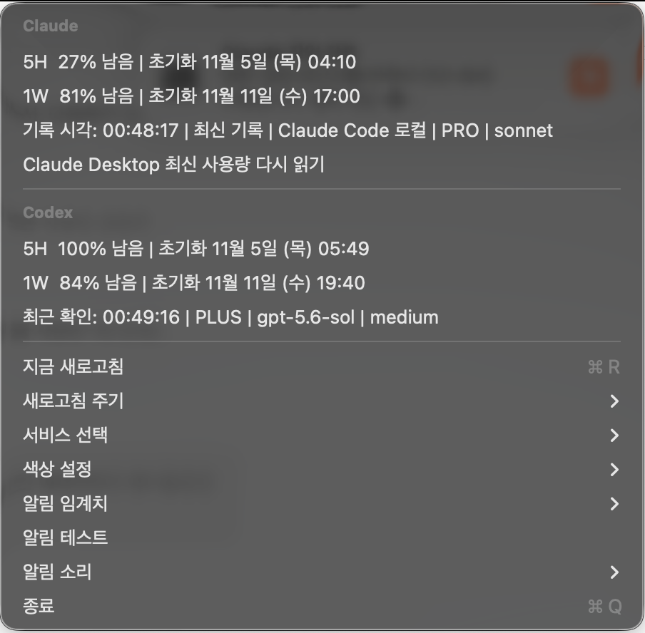

**English** · [한국어](README.ko.md)

# AI Usage Bar

A macOS menu bar app that shows how much of your **Claude** and **Codex (ChatGPT)** 5-hour and weekly
limits is left, and nudges you before a window resets with quota to spare.

It never sends a prompt or asks a model for anything. (That is **not** the same as "free of any cost or risk":
see [Accuracy and limitations](#accuracy-and-limitations).)

> Independent, unofficial tool. Not affiliated with Anthropic or OpenAI. Parts of it rely on undocumented
> interfaces; read [Accuracy and limitations](#accuracy-and-limitations) and the [Disclaimer](#disclaimer) before use.

## UI preview

**Menu bar** — Codex (left) and Claude (right). Top number: 5-hour **remaining %**. Bottom number: weekly remaining %.
Orange is the 5-hour window, blue is the weekly window. In this screenshot: Codex 100 / 84, Claude 27 / 81.


**Detail menu** — reset times, last record time, plan, model, and settings. In this screenshot: Claude 27% / 81% left,
Codex 100% / 84% left.



> The screenshots come from an earlier build. Newer menu items (reset-soon alert, usage coach, weekly pace line,
> live-usage and renewal toggles) are not shown, and the menu now says **stale** / **unknown** instead of a number when a
> value can't be trusted.

Only use one of the two services? Pick it on first launch (or any time from the menu).

## Features

- 5-hour and weekly **remaining %** for Claude and Codex in one compact menu bar item
- Reset time, last record time, plan and model in the detail menu; configurable refresh interval (30 s / 1 min / 5 min)
- **Stale / unknown instead of a wrong number.** A value that is old, or belongs to a window that already reset, is
  shown as `—` in the bar and labelled *stale* in the menu. It never triggers alerts or plans.
- Threshold alerts (e.g. 20/40/60/80/90/95 % used), custom thresholds, sound choice, test notification
- **Reset-soon alert**: a heads-up shortly before a 5-hour window resets while plenty is left (off by default; skipped if
  the weekly limit is nearly used up; honors your quiet hours — any number of time ranges)
- **Usage coach**: split the current 5-hour window into parts (e.g. 30 / 30 / 30) with a reminder at the start of each
  part; a fast-pace warning ("at this pace the limit runs out before the reset"); a weekly pace line ("about 20 % per
  day"); and a list of tasks you'd like to hand to Claude/Codex when quota is left. These are **reminders only** —
  the app never runs anything for you.
- Choose what the menu bar icons open (web Chat / Codex / Projects, or the desktop apps; Claude can open a new Code window)
- Optional jump to the desktop (Space) of a Claude session from a notification you wire up yourself ([hook](#notification-hook-optional))
- English by default, Korean when the system language is Korean (switchable in the menu)
- Launches at login, restarts after a crash (LaunchAgent); no Dock icon

## Accuracy and limitations

### Where the numbers come from

| Source | How it is read | What it is | Default |
| --- | --- | --- | --- |
| **Codex** | `codex app-server --stdio`, JSON-RPC `account/rateLimits/read`, using the official Codex CLI you already have | Official CLI, but the app-server protocol is marked **experimental** and may change | on (if Codex is selected) |
| **Claude, live** | `GET https://api.anthropic.com/api/oauth/usage` with the Claude Code sign-in token already on your Mac | **Unofficial, undocumented endpoint** and **reuse of a sign-in credential**. Whether this is allowed by Anthropic's terms is **uncertain** (see below) | **off until you allow it**; the dialog's default button is "No thanks" |
| **Claude Desktop record** | `~/Library/Application Support/Claude/plan-usage-history.json` | A local file Claude Desktop writes in its own internal format; not a documented interface | on (read-only) |
| **Claude Code local file** | `~/.claude/state/usage-monitor.json` | A local file that is **not** part of the official Claude Code. It only exists if something on your Mac writes it. Used only if present | on (read-only) |
| **Claude Desktop screen reading** | Accessibility API reading the usage indicators in the Claude Desktop UI | UI scraping, last-resort fallback, needs Accessibility permission | only when the other sources are stale and you have granted permission |

Claude Desktop's local record can lag by hours when you haven't used the app; without live usage the Claude numbers are
only as fresh as the local files. That is why they are marked **stale** rather than shown as if current.

### What "stale" and "unknown" mean

- **stale**: older than 30 minutes, or its reset time is already in the past (the value belongs to a finished window).
- **unknown**: no usable record time (or a time in the future).
- Stale and unknown values are never drawn as a percentage in the bar, and are never used for alerts, plans or coaching.
  This is covered by unit tests (`FreshnessTests`).

### "Never calls a model" is not "no cost or risk"

- The app never sends a prompt, so it does **not** spend model tokens from your quota.
- It does **not** follow that nothing is involved: the live Claude check is an HTTPS request to Anthropic's servers made
  with your sign-in. It can be rate-limited (HTTP 429; the app waits at least 2 minutes between calls and 15 minutes after
  a 429), it can stop working when Anthropic changes the endpoint, and Anthropic may treat it differently from official use.
- Reusing your Claude Code sign-in outside Claude Code **may not be permitted** by Anthropic's terms
  ([Claude Code legal and compliance](https://code.claude.com/docs/en/legal-and-compliance),
  [Consumer Terms](https://www.anthropic.com/legal/consumer-terms)). That is why the feature is opt-in, and why renewing an expired
  sign-in is a **separate, additional opt-in** (off by default). If you want zero exposure, decline live usage: the app still works
  from the local records.
- OpenAI's terms for ChatGPT-plan sign-in were not reviewable in full when this was written; check them yourself.

### Security notes

- The Claude token is read only after you allow live usage. It is kept in memory, never logged, never stored elsewhere, and sent
  only to `api.anthropic.com`.
- Renewing an expired token (opt-in) rotates Claude Code's own refresh token and writes it back to where Claude Code keeps it
  (`~/.claude/.credentials.json`, keeping owner-only permissions, or the macOS Keychain item `Claude Code-credentials`, same account
  name). If saving fails you may have to run `claude auth login`.
- Keychain access prompts come from macOS; choose **Always Allow** once rather than typing your password repeatedly.
- Screen Recording (to read window titles) and Accessibility (to press Space-switch shortcuts) are requested **only when you use
  a feature that needs them** (clicking a notification that jumps to a Claude window, or the "new window" icon action) — not at
  launch. The Claude Desktop screen-reading fallback never asks for permission itself; it only works if you already granted
  Accessibility. Nothing is recorded, stored or sent.
- The app does not read browser cookies or conversation contents.
- The Space jump uses private macOS APIs (CGS) and synthesized keyboard shortcuts; it can break after a macOS or Claude update.

### What has and has not been verified

- **Unit-tested** (43 tests, Swift Testing): usage parsing for every source, clamping and malformed input, HTTP 200/401/403/429/5xx,
  decode failure and connection loss for the Claude endpoint, credential parsing/expiry and file permissions, freshness rules,
  plan / pace / weekly-guide logic and quiet hours.
- **Checked by hand on the author's Mac (macOS 26)**: install, update over a running copy, crash restart, uninstall and reinstall;
  live Claude and Codex numbers compared against the local records.
- **Not verified**: the GitHub Actions workflow has not run yet; Intel Macs; macOS versions other than the author's; the Claude Desktop
  screen-reading fallback and the icon-click web/desktop destinations after the latest changes; the Korean/English UI for every message.
- The screenshots are from an earlier build.

## Install

Requirements: macOS 13+, Xcode Command Line Tools (to build; `xcode-select --install`), and Claude Desktop / Claude Code and/or
the [Codex CLI](https://github.com/openai/codex), signed in.

```bash
git clone https://github.com/sihunwang-skala/ai-usage-bar.git
cd ai-usage-bar
./install.sh
```

This builds a release binary, installs `AI Usage Bar.app` into `/Applications`, and registers a LaunchAgent so it starts at login.
See [INSTALL.md](INSTALL.md) for a walkthrough, including the "unidentified developer" warning.

- **Update**: pull and run `./install.sh` again. It stops the running copy, replaces the app and restarts it. Your settings are kept.
- **Uninstall**: `./uninstall.sh` removes the app and LaunchAgent and keeps your settings and logs; `./uninstall.sh --purge` also deletes
  settings and logs. Remove Screen Recording / Accessibility entries yourself in System Settings → Privacy & Security.
- **Keep macOS permissions across rebuilds** (optional): run `./setup-signing.sh` once. It creates a local signing certificate used
  only on this Mac. Without it, builds are ad-hoc signed and macOS asks for the permissions again after every build.
- **Custom CLI locations**: set `CODEX_PATH` / `CLAUDE_PATH` in the LaunchAgent plist (`EnvironmentVariables`).

## Technical overview

```
Sources/AIUsageBar
├─ Claude/        ClaudeOAuthUsageReader (live endpoint, token handling) · ClaudeModels (local record parsers) ·
│                 ClaudeDesktopAccessibilityReader (screen-reading fallback) · ClaudeWindowFocuser (Space jump)
├─ Codex/         CodexAppServerClient (JSON-RPC over stdio) · CodexModels (parser)
├─ Combined/      CombinedStatusController (menu bar UI, menu, refresh timers, throttling)
├─ Coach/         UsageCoach (plan, pace, weekly guide) · CoachMenu
├─ Notifications/ ThresholdNotifier (threshold and reset-soon alerts)
├─ UsageFreshness.swift   fresh / stale / unknown rules
└─ *Preferences.swift, Localization.swift, IconClickAction.swift, AppDelegate.swift, main.swift
Tests/AIUsageBarTests     Swift Testing suites
```

- Swift 6, SwiftPM, no third-party dependencies, `LSUIElement` menu bar app, LaunchAgent `com.aiusagebar.app`.
- Notifications need the bundled `.app` (`UNUserNotificationCenter`); `./run.sh` runs the raw binary without notifications.
- Logs: `~/Library/Logs/AIUsageBar/ai-usage-bar.log`.

### Develop

```bash
./run.sh              # quick run, no notifications
./build-app.sh        # dist/AIUsageBar.app
./scripts/test.sh     # swift test (adds Swift Testing paths on Command Line Tools-only Macs)
```

CI (`.github/workflows/ci.yml`, macOS runner): build, unit tests, app bundle build, `plutil -lint`, shell syntax check.

## Notification hook (optional)

If you use Claude Code hook scripts to send "task done" notifications, they can work with this app:

- **Jump to the right desktop.** Make the notification open `aiusagebar://claude-session?id=<Claude Desktop session id>`
  (the `local_…` id). AI Usage Bar then switches to the desktop (Space) where that session is open.
  This needs Screen Recording (to read window titles) and Accessibility (to press the Space-switch shortcuts).
  Turn on "Switch to Desktop N" in System Settings → Keyboard → Keyboard Shortcuts → Mission Control for one-step jumps;
  without it the app moves one desktop at a time.
- **Avoid double notifications.** The menu item **Task-done notifications** stores your choice. A hook can read it with
  `defaults read com.aiusagebar.app taskNotificationSource`; `claude` means "use Claude's own notifications, so don't send one".

The hook scripts themselves are not included in this repository.

## Troubleshooting

### Not showing up in the menu bar

```bash
ps aux | grep "[A]IUsageBar"
launchctl print gui/$(id -u)/com.aiusagebar.app
```

### A block shows `— —` or an old timestamp

- Claude: values older than 30 minutes (or from a finished window) are shown as `—` / *stale* on purpose. Allow live usage in
  the menu, or use Claude Desktop / Claude Code so the local records refresh. Stale values never trigger alerts.
- Codex: run `codex login status` to confirm login.

### No notifications

Choose **Test notification** (알림 테스트) from the app menu. If it reports that notifications are disabled, enable
System Settings → Notifications → AI Usage Bar. Notifications only work when running from the
installed `.app` bundle (see Technical overview above).

## License & Copyright

Copyright © 2026 Sihun Wang.

Licensed under the [PolyForm Noncommercial License 1.0.0](LICENSE).

- **You may:** download and use this app for personal and other noncommercial purposes, and study or modify
  the source for your own noncommercial use.
- **You may also:** share copies with others for noncommercial purposes, as long as you pass along the license text
  (the license's own terms apply; this README is a summary, not a replacement).
- **You may not:** use it commercially, or sell it, without prior written permission from the author. The license
  does not grant any right to the "AI Usage Bar" name or app icon beyond identifying this project.
- This is a **source-available** license, not an OSI-approved open-source license.
- The license covers this project's own code and documents only. It does **not** cover the Claude / ChatGPT / Codex
  names and logos, or Anthropic's and OpenAI's services and terms.

For commercial licensing, collaboration, or other inquiries, please contact the repository owner.

### Trademarks, logos, and third-party materials

- **Claude**, **Claude Code**, **Anthropic**, and their logos are trademarks of **Anthropic, PBC**.
  **ChatGPT**, **Codex**, **OpenAI**, and their logos are trademarks of **OpenAI**.
- The Claude and ChatGPT/Codex icons shown in the menu bar and in the screenshots (`docs/*.png` contain them) are the
  **official logos and app icons of Anthropic and OpenAI**. They are used only to identify those services
  (nominative use). All rights to them belong to their respective owners. They are **not** covered by this
  project's license and remain subject to the owners' brand guidelines.
- The app itself does not bundle those icons. It reads them from your own installed Claude and Codex apps.
- This project is an independent, unofficial tool. It is **not affiliated with, endorsed by, or sponsored by**
  Anthropic or OpenAI.
- If a rights holder objects to the use of any logo or name, please contact the repository owner and it will be
  removed promptly.
- This project has no third-party code dependencies. (Tests use Apple's Swift Testing; CI uses GitHub-hosted runners.)

### Disclaimer

- The app relies on **undocumented endpoints and private macOS APIs** that can change or stop working at any time.
- Using your login token with an unofficial tool may not be permitted by the provider's terms of service.
  That is why the feature is opt-in. Please review Anthropic's and OpenAI's terms yourself. **You use this
  at your own risk and responsibility.**
- The software is provided "as is", without warranty of any kind, and the author is not liable for any damages
  (see the [LICENSE](LICENSE)).
- Usage numbers are for reference only and may differ from the official figures.
